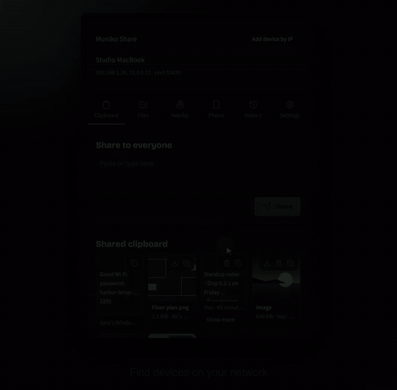
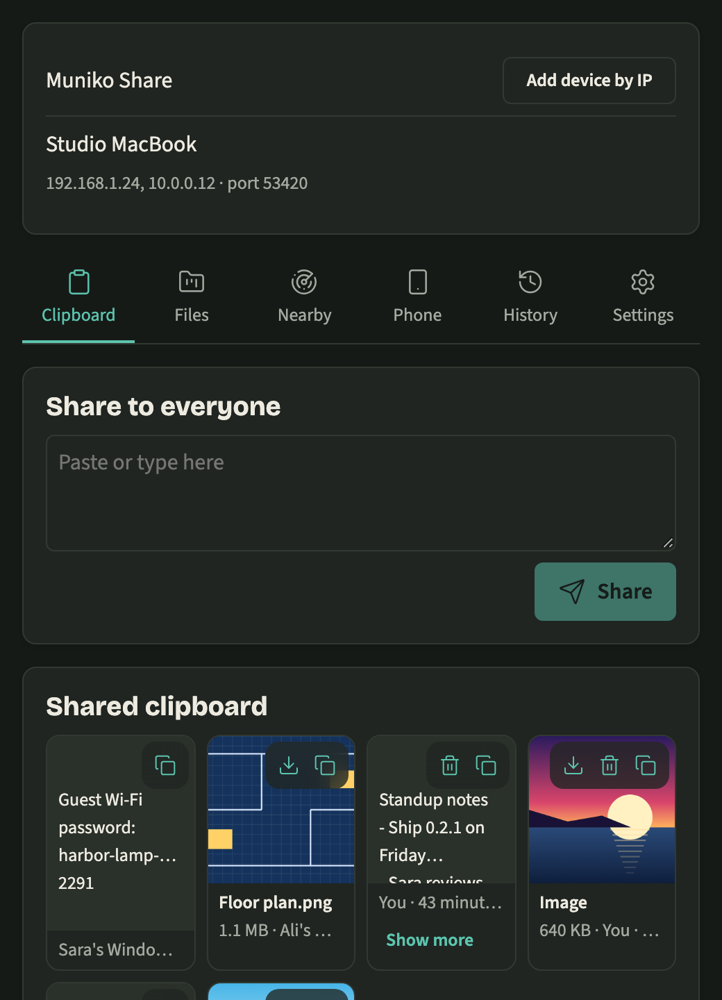
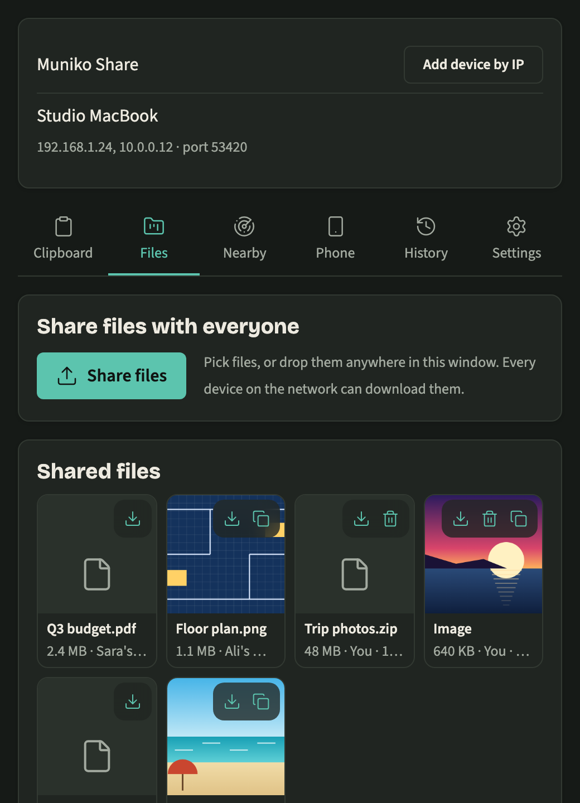
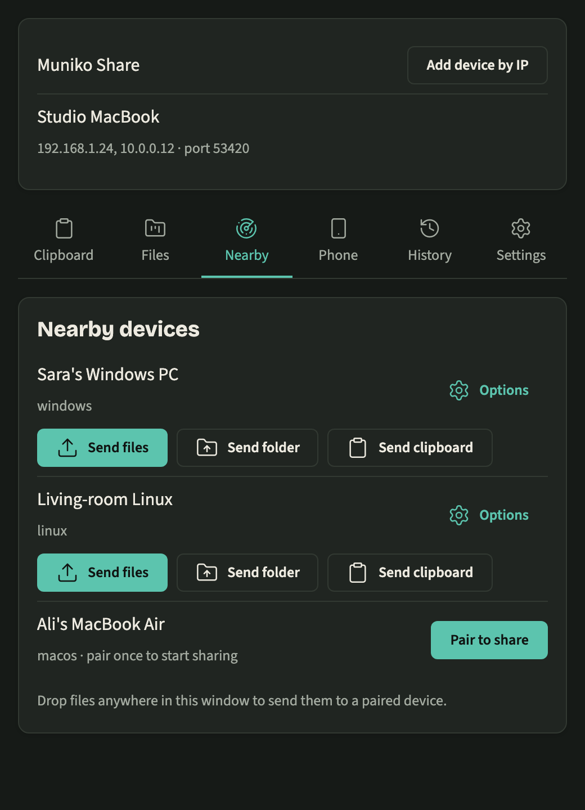

# Muniko Share

Send files and copied text between your computers at home or at work. 
Everything stays on your own network. You don't need an account or the internet.

## Download

Get the latest version from the [Releases page](https://github.com/Ayesh96/MunikoShare/releases/latest).

* **Windows:** the file that ends in `setup.exe`
* **Mac:** the file that ends in `.dmg`
* **Linux:** the `.AppImage` file

The app isn't registered with Apple or Microsoft yet, so your computer may block it the first time.

* **Windows:** click More info, then Run anyway.
* **Mac:** open the app once. When macOS blocks it, go to System Settings, then Privacy & Security, scroll down and click Open Anyway.
* **Linux:** right click the file, open Properties, then Permissions, and allow it to run as a program.

## Getting started

1. Install Muniko Share on two computers that use the same WiFi.
2. Open it on both. If your computer asks whether to allow network access, say yes.
3. On one computer, open the Nearby tab and click Pair to share next to the other computer.
4. The other computer shows a code. Type it in and click Confirm.

You only need to pair once.

Closing the window doesn't quit Muniko Share. It keeps running in the menu bar or system tray, so files can still reach you.

## What you can do

### Send files

Drag files into the window and pick a computer. On Windows you can also right click a file and choose Send to, then Muniko Share. On Windows 11, Send to is under Show more options.

The other computer asks before saving anything. If you trust a computer, turn on Accept files without asking for it in the Nearby tab.

Files you receive go to a Muniko Share folder inside your Downloads folder. You can pick a different folder in Settings.

### Share your clipboard

Copy something, then press Ctrl+Shift+V (Cmd+Shift+V on a Mac). It shows up on your paired computers.

To share every copy without pressing anything, turn on Sync clipboard automatically for that computer in the Nearby tab. Do this on both computers. Most password managers mark copied passwords as private, and on Windows and Mac, Muniko Share leaves those out.

### Share with everyone

Anything you paste in the Clipboard tab or add in the Files tab goes to every computer on your network running Muniko Share. People who open the app later will see it too.

### Use your phone

Your phone doesn't need an app. Open the Phone tab, turn on phone access, click Connect phone and scan the code with your phone's camera. A page opens in your phone's browser where you can send and receive files and text.

The first time, your phone may show a security warning. This is normal. Tap Advanced or Show details, then continue to the page.

## Screenshots

<table>
  <tr>
    <td width="33%">
      <picture>
        <source media="(prefers-color-scheme: light)" srcset="docs/assets/screenshots/01-clipboard-light.png">
        
      </picture>
    </td>
    <td width="33%">
      <picture>
        <source media="(prefers-color-scheme: light)" srcset="docs/assets/screenshots/02-files-light.png">
        
      </picture>
    </td>
    <td width="33%">
      <picture>
        <source media="(prefers-color-scheme: light)" srcset="docs/assets/screenshots/03-nearby-light.png">
        
      </picture>
    </td>
  </tr>
</table>

## Privacy

Your files go straight from one computer to the other over your own network. They never go through the internet or anyone's server. Connections are encrypted, and a computer must be paired with yours before it can send you files directly.

What you share with everyone is different. Anyone on the same network who runs Muniko Share can see it, so be careful on cafe, hotel or other public WiFi.

## Help

**The other computer doesn't show up.**
Check that both are on the same WiFi. Guest networks and some office networks stop computers from seeing each other. Click Add device by IP and type the address shown at the top of the other computer's window.

**Windows can't find anything.**
Open Settings, then Network & internet, then WiFi, choose your network and set it to Private. Also allow Muniko Share through the firewall if Windows asks.

**The clipboard doesn't sync on Linux.**
Some Linux desktops don't let apps watch the clipboard. Press Ctrl+Shift+V to send it instead.

**You use a VPN.**
Some VPNs hide your local network. Turn the VPN off and try again.

## License

Free to use at home or at work. You can't sell it or give out copies of it. Please download it only from the [Releases page](https://github.com/Ayesh96/MunikoShare/releases). See [LICENSE](LICENSE) for the full terms.
